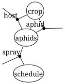
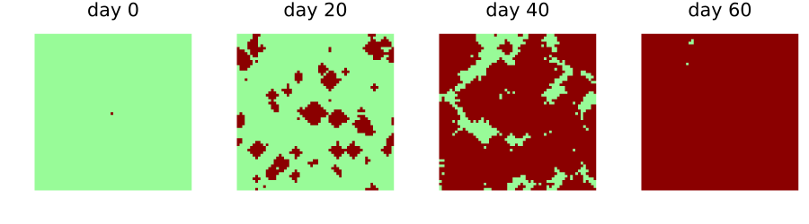
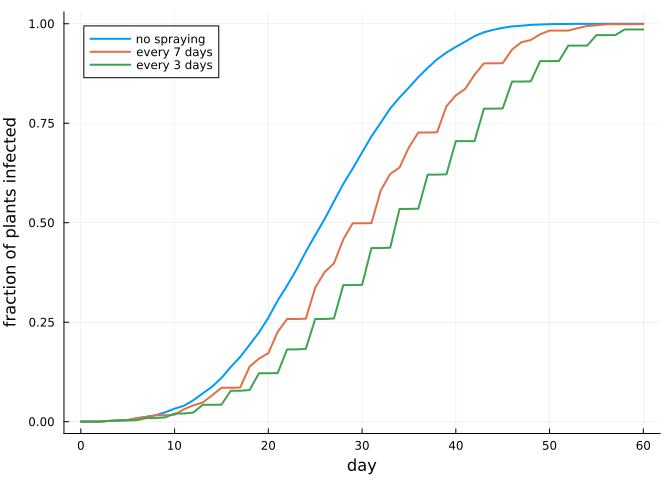

# Composing models over shared layers
Simon Frost

- [Overview](#overview)
- [Three models](#three-models)
- [The diagram](#the-diagram)
- [Running it](#running-it)
- [Who updates a layer](#who-updates-a-layer)
- [Random numbers per model](#random-numbers-per-model)

## Overview

A field model is often written by several people: one models the crop,
another the vector, a third the spraying programme. Each part is a
CellularAutomataCore model of its own, with its own state layers,
parameters and random numbers. This vignette composes such models along
an undirected wiring diagram. Boxes are models, junctions are shared
layers, and the composite is again a `CAModel` that runs on any backend.

The construction applies the product theorem of the earlier vignettes to
whole models. The composite updates every layer at once, and is the
pairing of each model’s update of the layers it owns. Composing models
this way is a **research extension** beyond the papers, in the spirit of
the resource sharers of AlgebraicDynamics.jl.

``` julia
ENV["GKSwstype"] = "100"
using CategoricalCellularAutomata
using Catlab: Catlab, @relation, to_graphviz
using CellularAutomataCore: CellularAutomataCore, @camodel, CAProblem, Torus, solve, states,
                            defaults, bernoulli, VonNeumann
using Plots
using Statistics
```

## Three models

The crop: a healthy plant (0) is infected (1) with probability `β` when
two or more aphids are on it. It reads the aphid layer but does not
change it.

``` julia
crop = @camodel Crop begin
    @states host::Int8 = 0 aphid::Int8 = 0
    @parameters β = 0.5
    @neighbourhood VonNeumann(1)
    @rule begin
        infected = cell.host == 1 || (cell.aphid >= 2 && bernoulli(ctx, β, 1))
        (host=Int8(infected), aphid=cell.aphid)
    end
end
```

    CAModel Crop
      states:
        host::Int8 = 0
        aphid::Int8 = 0
      parameters:
        β = 0.5
      rule: LocalRule(<anonymous function>, VonNeumann(1))

The aphids breed to density 3 on infected plants and spread from crowded
cells, losing one level as they move. A few fly in from outside, and a
spray kills them all where it is applied.

``` julia
aphids = @camodel Aphids begin
    @states host::Int8 = 0 aphid::Int8 = 0 spray::Int8 = 0
    @parameters immigration = 0.002
    @neighbourhood VonNeumann(1)
    @rule begin
        a = if cell.spray == 1
            Int8(0)
        elseif cell.host == 1
            Int8(3)
        else
            spread = max(cell.aphid, maximum(n.aphid for n in nbrs)) - 1
            Int8(max(spread, bernoulli(ctx, immigration, 1) ? 2 : 0))
        end
        (host=cell.host, aphid=a, spray=cell.spray)
    end
end
```

    CAModel Aphids
      states:
        host::Int8 = 0
        aphid::Int8 = 0
        spray::Int8 = 0
      parameters:
        immigration = 0.002
      rule: LocalRule(<anonymous function>, VonNeumann(1))

The spraying programme sprays every field cell on one day in `every`.

``` julia
schedule = @camodel Schedule begin
    @states spray::Int8 = 0
    @parameters every = 7
    @neighbourhood VonNeumann(1)
    @rule Int8(ctx.t % every == every - 1)
end
```

    CAModel Schedule
      states:
        spray::Int8 = 0
      parameters:
        every = 7
      rule: LocalRule(<anonymous function>, VonNeumann(1))

## The diagram

Catlab’s `@relation` writes the wiring: each model is a box, listed with
the layers it shares, and each shared layer is a junction.

``` julia
field = @relation (host, aphid, spray) begin
    crop(host, aphid)
    aphids(host, aphid, spray)
    schedule(spray)
end
to_graphviz(field; box_labels=:name, junction_labels=:variable)
```



Each box is an `OpenCAModel`: a model, the layers it exposes as ports
(in the order of the box’s ports), and the layers it reads without
updating. Every layer must have at most one model that updates it: the
crop owns `host`, the aphids own `aphid`, and the schedule owns `spray`.

``` julia
boxes = (crop=OpenCAModel(crop; reads=[:aphid]),
         aphids=OpenCAModel(aphids; reads=[:host, :spray]),
         schedule=OpenCAModel(schedule))
model = oapply(field, boxes; name=:Field)
```

    CAModel Field
      composite of crop, aphids, schedule
      states:
        host::Int8 = 0
        aphid::Int8 = 0
        spray::Int8 = 0
      parameters:
        crop = (β = 0.5,)
        aphids = (immigration = 0.002,)
        schedule = (every = 7,)
      rule: LocalRule(crop + aphids + schedule, Offsets((0, -1), (-1, 0), (1, 0), (0, 1)))

The composite is an ordinary `CAModel`. Its states are the junctions,
and its parameters are those of each box, under the box’s name:

``` julia
([s.name for s in states(model)], defaults(model))
```

    ([:host, :aphid, :spray], (crop = (β = 0.5,), aphids = (immigration = 0.002,), schedule = (every = 7,)))

## Running it

``` julia
space = Torus(60, 60)
host0 = zeros(Int8, 60, 60)
host0[30, 30] = 1
sprayed = solve(CAProblem(model, (host=host0,), 60; space, seed=1); saveat=20)
plot([heatmap(u.host; c=[:palegreen, :darkred], clims=(0, 1), colorbar=false,
              aspect_ratio=:equal, framestyle=:none, title="day $t")
      for (t, u) in zip(sprayed.t, sprayed.u)]...; layout=(1, 4), size=(900, 250))
```



The same models without the spraying programme are another diagram. Its
spray layer has no model to update it, so it keeps its initial state,
zero: no spraying.

``` julia
unsprayed_field = @relation (host, aphid, spray) begin
    crop(host, aphid)
    aphids(host, aphid, spray)
end
unsprayed = oapply(unsprayed_field, (crop=boxes.crop, aphids=boxes.aphids))
```

    CAModel composite
      composite of crop, aphids
      states:
        host::Int8 = 0
        aphid::Int8 = 0
        spray::Int8 = 0
      parameters:
        crop = (β = 0.5,)
        aphids = (immigration = 0.002,)
      rule: LocalRule(crop + aphids, Offsets((0, -1), (-1, 0), (1, 0), (0, 1)))

Parameters are set per box. Here the programme sprays every 7 days,
every 3 days, or not at all:

``` julia
infected(sol) = [mean(u.host) for u in sol.u]
runs = ["no spraying" => solve(CAProblem(unsprayed, (host=host0,), 60; space, seed=1)),
        "every 7 days" => solve(CAProblem(model, (host=host0,), 60; space, seed=1)),
        "every 3 days" => solve(CAProblem(model, (host=host0,), 60, (schedule=(every=3,),);
                                          space, seed=1))]
plot(; xlabel="day", ylabel="fraction of plants infected", legend=:topleft)
for (label, sol) in runs
    plot!(sol.t, infected(sol); label, lw=2)
end
current()
```



## Who updates a layer

Two models that both update the same layer cannot be composed, because
their updates would race. A second crop model that also updates `host`
is refused:

``` julia
field2 = @relation (host, aphid, spray) begin
    crop(host, aphid)
    blight(host, aphid)
    aphids(host, aphid, spray)
end
try
    oapply(field2, (crop=boxes.crop, blight=OpenCAModel(crop; reads=[:aphid]),
                    aphids=boxes.aphids))
catch err
    sprint(showerror, err)
end
```

    "LayerConflictError: layer host would be updated by crop and blight; declare it in `reads` for all but one of them"

## Random numbers per model

Each box draws its own random numbers, from a seed derived from its
name, so the crop and the aphids, which both use draw number 1, are
independent. This is the independent coupling of the stochastic
vignette. With `shared_randomness=true` the boxes see the same uniforms,
which couples them: the crop’s infection draw and the aphids’
immigration draw at a cell become the same number, so aphids fly in only
where an infection draw would also succeed. Whether that matters is a
question about the model. Here it does not matter much, as the fraction
infected on day 30 over 20 seeds shows:

``` julia
shared = oapply(field, boxes; shared_randomness=true)
day30(m) = [mean(solve(CAProblem(m, (host=host0,), 30; space, seed);
                       save_everystep=false).u[end].host) for seed in 1:20]
summary(v) = (mean=round(mean(v); digits=3), sd=round(std(v); digits=3))
(independent=summary(day30(model)), shared=summary(day30(shared)))
```

    (independent = (mean = 0.582, sd = 0.054), shared = (mean = 0.571, sd = 0.06))

The two means differ by less than their standard errors. Immigration is
rare, and an immigrant aphid only matters at a later step, through draws
that are not shared. The default keeps the boxes’ randomness apart, so
that composing two models never couples them by accident, and the option
makes coupling a choice that can be tested, as here.
