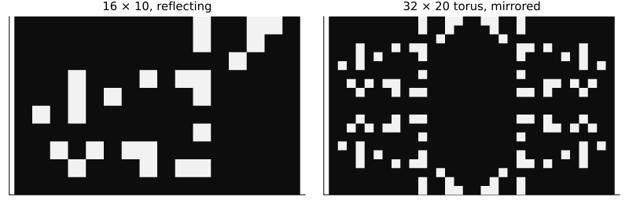
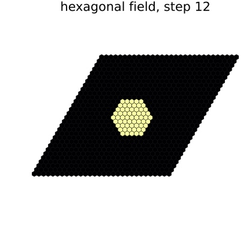
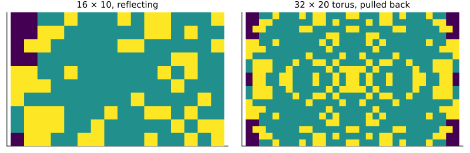

# Geometries
Simon Frost

- [Overview](#overview)
- [Square and hexagonal tori](#square-and-hexagonal-tori)
- [Periodic edges are quotients](#periodic-edges-are-quotients)
- [Reflecting edges are quotients by
  reflections](#reflecting-edges-are-quotients-by-reflections)
- [Constant edges are pinned cells](#constant-edges-are-pinned-cells)
- [Graphs](#graphs)
- [Composites on any geometry](#composites-on-any-geometry)
- [Moving a model between spaces](#moving-a-model-between-spaces)
- [A category of spaces](#a-category-of-spaces)
- [Summary](#summary)

## Overview

The earlier vignettes study cellular automata over groups: the cells are
the elements of a group, and every cell reads the same pattern of
neighbours. Real models run on other geometries too: hexagonal grids,
fields with reflecting or fixed edges, networks of patches. This
vignette represents all of them in one way, and relates them by maps.

A **space** here is a finite set of cells, each with an ordered list of
neighbours. When every cell has `k` neighbour slots, that is a coalgebra
of `X ↦ X^k`: a set with `k` functions to itself, one for each slot. A
graph, whose cells have lists of different lengths, is a coalgebra of
the list functor. A **map of spaces** sends cells to cells and each
neighbour to the corresponding neighbour of the image. Pulling a
configuration back along such a map, reading each cell’s value at its
image, commutes with every cellular automaton given by a local rule:
running the rule and then pulling back is the same as pulling back and
then running the rule. In the language of category theory, a local rule
is a natural transformation between configuration functors on the
category of spaces.

This is a **research extension**, beyond the papers the package
implements. Each geometry below is checked against CellularAutomataCore,
which runs the same rules on its own spaces.

``` julia
ENV["GKSwstype"] = "100"
using CategoricalCellularAutomata
using CellularAutomataCore: CellularAutomataCore, CAProblem, solve, ReferenceBackend, Torus,
                            Grid, HexGrid, GraphSpace, Life, Hexagonal, Moore, VonNeumann,
                            Reflecting, Constant, Periodic, LocalRule, GraphNeighbours,
                            CAModel, neighbourhood_offsets
using Catlab: @relation, compose, id, dom
using Plots
using Random
core_step(rule, space, u) = solve(CAProblem(rule, u, 1; space); backend=ReferenceBackend()).u[end]
```

## Square and hexagonal tori

`neighbourhood_space` turns any CellularAutomataCore space and
neighbourhood into a space of this kind, with the neighbours in the
order the core gives them to a rule. A square torus and a hexagonal one
have the same cells, the elements of the group `Z_8 × Z_6`; they differ
only in which elements a cell reads. Both are Cayley spaces of that
group, marked with different generators:

``` julia
G = TorusGroup(8, 6)
square = cayley_space(G, [(1, 0), (-1, 0), (0, 1), (0, -1)])
hexagonal = cayley_space(G,
                         [Tuple(o) for o in neighbourhood_offsets(Hexagonal(1), HexGrid(8, 6))])
(square=square, hexagonal=hexagonal,
 same_as_core=hexagonal == neighbourhood_space(HexGrid(8, 6), Hexagonal(1)))
```

    (square = NeighbourhoodSpace(48 cells, 4 neighbour slots), hexagonal = NeighbourhoodSpace(48 cells, 6 neighbour slots), same_as_core = true)

The geometry is the marking, not the group. Life on the hexagonal space,
stepped with `apply_local`, is the core’s hexagonal Life:

``` julia
u = rand(Xoshiro(1), 0:1, 8, 6)
apply_local(Life(), hexagonal, vec(u)) == vec(core_step(Life(), HexGrid(8, 6), u))
```

    true

A cellular automaton over a group, as in the earlier vignettes, is the
special case: its memory set marks the group, and
`neighbourhood_space(τ)` is its Cayley space.

## Periodic edges are quotients

A 12 × 8 torus covers a 6 × 4 one: send each cell to its position modulo
`(6, 4)`. Every cell’s neighbours go to the neighbours of its image, so
`covering` is a map of spaces, and a configuration on the small torus
pulls back to a periodic one on the large torus. Running a rule on
either side and comparing:

``` julia
f = covering(Torus(12, 8), Torus(6, 4), Moore(1))
x = rand(Xoshiro(2), 0:1, 24)
(is_morphism=is_morphism(f),
 commutes=apply_local(Life(), f.dom, pullback(f, x)) ==
          pullback(f, apply_local(Life(), f.codom, x)))
```

    (is_morphism = true, commutes = true)

Periodic edges are therefore the quotient of a larger (in the limit,
infinite) lattice by translations: a cellular automaton on a torus is
the same automaton on the plane, restricted to periodic configurations.

## Reflecting edges are quotients by reflections

A lattice whose edges mirror the cells inside (`Reflecting` in the core)
is also a quotient, of the torus with each side doubled: on the second
half of an axis, a cell goes to its mirror image. Neighbours on the
mirrored half lie in the opposite direction, so the map sends each
neighbour slot to its reflection. `reflection_fold` records those
permutations, and only rules that do not care about the direction of
their neighbours, such as Life, commute with pulling back along it.

``` julia
space = Grid(16, 10; boundary=Reflecting())
fold = reflection_fold(space, Moore(1))
u = rand(Xoshiro(3), 0:1, 16, 10)
reflecting = solve(CAProblem(Life(), u, 20; space))
doubled = solve(CAProblem(Life(), reshape(pullback(fold, vec(u)), 32, 20), 20;
                          space=Torus(32, 20)))
all(t -> vec(doubled.u[t]) == pullback(fold, vec(reflecting.u[t])), eachindex(reflecting.u))
```

    true

Twenty steps of Life with reflecting edges are twenty steps on the
doubled torus from the mirrored start, read on one quarter of it:

``` julia
plot(heatmap(reflecting.u[end]'; c=:grays, colorbar=false, title="16 × 10, reflecting"),
     heatmap(doubled.u[end]'; c=:grays, colorbar=false, title="32 × 20 torus, mirrored");
     layout=(1, 2), size=(800, 260), aspect_ratio=1, ticks=false, yflip=true,
     titlefontsize=10)
```



A rule that does care, copying the neighbour on one side, does not
descend:

``` julia
copy_one = (c, nbrs) -> nbrs[4]
vn = reflection_fold(Grid(7, 5; boundary=Reflecting()), VonNeumann(1))
x = rand(Xoshiro(4), 0:1, 35)
apply_local(copy_one, vn.dom, pullback(vn, x)) ==
pullback(vn, apply_local(copy_one, vn.codom, x))
```

    false

## Constant edges are pinned cells

A lattice whose edges hold a constant (`Constant` in the core) gets one
extra cell for each constant, pinned to it: every neighbour beyond the
edge is that cell, and its own neighbours are itself. The space is then
a pointed extension of the cells inside.

``` julia
box = Grid(9, 7; boundary=(Constant(1), Constant(0)))
S = neighbourhood_space(box, Moore(1))
u = rand(Xoshiro(5), 0:1, 9, 7)
(space=S, pinned=S.pinned,
 same_as_core=apply_local(Life(), S, vec(u)) == vec(core_step(Life(), box, u)))
```

    (space = NeighbourhoodSpace(63 cells, 8 neighbour slots, 2 pinned), pinned = Dict{Int64, Any}(64 => 0, 65 => 1), same_as_core = true)

## Graphs

A `GraphSpace` from the core is a space whose cells have lists of
different lengths. Here are patches joined to their neighbours along a
ring and by a few long links, and a majority rule:

``` julia
links = [(i, mod1(i + 1, 30)) for i in 1:30]
append!(links, [(1, 16), (5, 20), (9, 25)])
patches = GraphSpace(30, links)
majority = LocalRule(GraphNeighbours()) do c, n, ctx
    k = 2count(==(1), n)
    return k > length(n) ? 1 : k < length(n) ? 0 : c
end
P = neighbourhood_space(patches)
x = rand(Xoshiro(6), 0:1, 30)
(space=P, same_as_core=apply_local(majority, P, x) == core_step(majority, patches, x))
```

    (space = NeighbourhoodSpace(30 cells, neighbour lists of (2, 3) cells), same_as_core = true)

## Composites on any geometry

The models composed in the previous vignette resolved their
neighbourhoods on a square lattice. `oapply` now takes the `space` the
composite will run on: models with hexagonal neighbourhoods compose on a
hexagonal grid, and models that read `GraphNeighbours()` on a graph.
Here is the crop and aphid model of that vignette on hexagonal cells:

``` julia
function crop_and_aphids(nbhd)
    crop = CAModel(LocalRule(nbhd) do c, n, ctx
                       return (host=c.host == 1 || c.aphid >= 2 ? Int8(1) : Int8(0),
                               aphid=c.aphid)
                   end; name=:crop, states=(host=Int8(0), aphid=Int8(0)))
    aphids = CAModel(LocalRule(nbhd) do c, n, ctx
                         a = c.host == 1 ? Int8(3) :
                             Int8(max(0, max(c.aphid, maximum(m.aphid for m in n)) - 1))
                         return (host=c.host, aphid=a)
                     end; name=:aphids, states=(host=Int8(0), aphid=Int8(0)))
    d = @relation (host, aphid) begin
        crop(host, aphid)
        aphids(host, aphid)
    end
    return d,
           (crop=OpenCAModel(crop; reads=[:aphid]), aphids=OpenCAModel(aphids; reads=[:host]))
end
d, boxes = crop_and_aphids(Hexagonal(1))
hexfield = HexGrid(30, 30)
model = oapply(d, boxes; space=hexfield)
host = zeros(Int8, 30, 30)
host[15, 15] = 1
sol = solve(CAProblem(model, (host=host,), 12; space=hexfield))
plot(sol; snapshot=length(sol.u), layer=:host, colorbar=false,
     title="hexagonal field, step 12", size=(420, 380))
```



The infection spreads as a hexagon, the shape of the balls of the
hexagonal neighbourhood.

## Moving a model between spaces

Pulling back a configuration and rerunning the same rule only works for
rules that do not care about the slot permutations.
`pullback(f, prob; space)` moves a whole problem instead: the initial
state, covariates and mask are pulled back, and each cell of the new
space runs the rule of its image, reading its neighbours in its image’s
slot order and drawing its image’s random numbers. Its solution is the
pullback of the original solution, for every rule, stochastic or not,
symmetric or not.

Here is an epidemic carried by a wind from the west: an infected
neighbour on the west side infects far more often than one on the east.
The field has reflecting edges, so it is a quotient of the doubled torus
by reflections, and on the mirrored halves the west side of a cell is
its image’s east side.

``` julia
using CellularAutomataCore: @camodel, bernoulli
field = Grid(16, 10; boundary=Reflecting())
offsets = collect(neighbourhood_offsets(Moore(1), field))
weights = Tuple(o[1] < 0 ? 0.7 : 0.05 for o in offsets)
windy = @camodel WindySIR begin
    @states state::Symbol = :S ∈ (:S, :I, :R)
    @parameters γ = 0.15
    @neighbourhood Moore(1)
    @rule begin
        if cell == :S
            escape = prod(n == :I ? 1 - w : 1.0 for (n, w) in zip(nbrs, weights))
            bernoulli(ctx, 1 - escape, 1) ? :I : :S
        elseif cell == :I
            bernoulli(ctx, γ, 2) ? :R : :I
        else
            cell
        end
    end
end
start = I -> I == CartesianIndex(3, 5) ? :I : :S
prob = CAProblem(windy, (; state=start), 18; space=field, seed=5)
fold = reflection_fold(field, Moore(1))
moved = pullback(fold, prob; space=Torus(32, 20))
sol, big = solve(prob), solve(moved)
all(t -> big.u[t] == pullback(fold, sol.u[t]; space=Torus(32, 20)), eachindex(sol.u))
```

    true

The run on the doubled torus is the run on the field, mirrored into each
quarter (purple susceptible, green recovered, yellow infected); on the
mirrored halves the wind blows from the east:

``` julia
code(u) = map(s -> s == :S ? 0 : s == :I ? 2 : 1, u)
plot(heatmap(code(sol.u[end])'; c=:viridis, colorbar=false, clims=(0, 2),
             title="16 × 10, reflecting"),
     heatmap(code(big.u[end])'; c=:viridis, colorbar=false, clims=(0, 2),
             title="32 × 20 torus, pulled back");
     layout=(1, 2), size=(800, 260), aspect_ratio=1, ticks=false, yflip=true,
     titlefontsize=10)
```



The same rule rerun on the torus from the mirrored start, with each cell
drawing its own random numbers and reading its own west neighbour, is a
different epidemic:

``` julia
rerun = solve(CAProblem(windy, (; state=moved.u0), 18;
                        space=Torus(32, 20), seed=5))
rerun.u[end] == big.u[end]
```

    false

## A category of spaces

Maps of spaces compose: cells go through both maps, and the slot
permutations compose with them. With identities, neighbourhood spaces
and their maps form a category, an instance of Catlab’s `ThCategory`,
and pulling back configurations is a contravariant functor out of it. A
covering of a 24 × 16 torus over the 12 × 8 one, followed by the 12 × 8
torus’s covering of the 6 × 4 one, is the covering of the 6 × 4 torus by
the 24 × 16 one; and a covering followed by a fold is again a map of
spaces:

``` julia
a = covering(Torus(24, 16), Torus(12, 8), Moore(1))
b = covering(Torus(12, 8), Torus(6, 4), Moore(1))
fold6 = reflection_fold(Grid(6, 4; boundary=Reflecting()), Moore(1))
h = compose(a, fold6)
x = rand(Xoshiro(7), 0:1, 24)
(coverings_compose=compose(a, b) == covering(Torus(24, 16), Torus(6, 4), Moore(1)),
 identity=compose(id(dom(a)), a) == a, composite_is_a_map=is_morphism(h),
 pullback_is_functorial=pullback(h, x) == pullback(a, pullback(fold6, x)))
```

    (coverings_compose = true, identity = true, composite_is_a_map = true, pullback_is_functorial = true)

## Summary

| geometry | as a space | relation to the plane |
|----|----|----|
| square or hexagonal torus | Cayley space of `Z_n × Z_m`, marked by the neighbourhood | quotient by translations (`covering`) |
| reflecting edges | lattice whose edge cells read their mirror images | quotient of a doubled torus by reflections (`reflection_fold`): symmetric rules descend as they are, any problem moves with `pullback` |
| constant edges | lattice plus a pinned cell for each constant | pointed extension |
| graph | lists of varying length | none: a space in its own right |

In each case a local rule is the same thing, a function of a cell and
its neighbours, and the maps between spaces carry configurations and the
rule’s dynamics together. Pulling a whole problem back along a map moves
a model, random numbers included, from one space to another.
