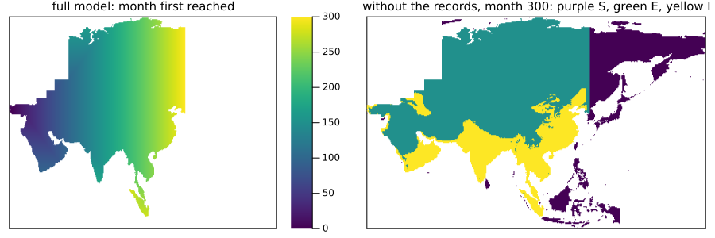

# Maps between zoo models
Simon Frost

- [Overview](#overview)
- [Forgetting what a model only
  records](#forgetting-what-a-model-only-records)
- [A management model and its base
  model](#a-management-model-and-its-base-model)
- [Percolation inside a viral front](#percolation-inside-a-viral-front)
- [Which layers feed back?](#which-layers-feed-back)
- [What this does not reach](#what-this-does-not-reach)
- [Summary](#summary)
- [References](#references)

## Overview

The vignette on maps between models used small examples written for the
purpose. This one tries the same ideas on the published models of
EcologicalCellularAutomata, where the rules were written for other
reasons and much of the dynamics lives outside them. Three relations
turn out to hold exactly, and the attempt shows what a map of models
cannot see.

A map of models compares rules, but a zoo problem is more than its rule:
it may have covariates, kernel fields and callbacks acting on the whole
lattice. So there are two checks. `is_model_map(f)` tests the rules on
local configurations. `is_model_map(f, prob)` runs both models on one
problem and compares every saved state exactly, and is the only one that
sees the rest. Its `true` holds for that problem.

This is a **research extension**, beyond the papers the package
implements. The package does not depend on the zoo; only this vignette
loads it.

``` julia
ENV["GKSwstype"] = "100"
using CategoricalCellularAutomata
using EcologicalCellularAutomata
using CellularAutomataCore: CellularAutomataCore, CAProblem, solve, remake, Torus, Margolus,
                            Synchronous, DiscreteCallback, CallbackSet
using Catlab: codom
using Plots
```

## Forgetting what a model only records

The *Tuta absoluta* model follows the leafminer’s spread across Asia on
monthly climate data ([Guimapi et al. 2020](#ref-Guimapi2020)). Each
land cell is susceptible, exposed or invaded, and two more layers record
the months it was first reached and invaded. `forget_layers` builds the
model without them from the same rule, so no second copy of the rule can
drift from the first. Whether the result is a map is a real question,
answered here by running 300 months over the real climate:

``` julia
tuta = build(:tuta_absoluta_asia)
plain_tuta = forget_layers(tuta, :reached, :invaded)
tprob = problem(:tuta_absoluta_asia)
(codomain=codom(plain_tuta).name, months=tprob.tspan[2],
 is_model_map=is_model_map(plain_tuta, tprob),
 land_can_be_forgotten=is_model_map(forget_layers(tuta, :land), tprob))
```

    (codomain = :tuta_absoluta_asia_without_reached_invaded, months = 300, is_model_map = true, land_can_be_forgotten = false)

The records add nothing to the dynamics, only a history that the smaller
model cannot give: the figure sets the month each cell was reached
beside the stage that the smaller model holds at the end. Forgetting
`land` instead is not a map, since the rule reads it.

``` julia
u = solve(tprob).u[end]
small = pushforward(plain_tuta, u)
northup(a) = reverse(a; dims=1)
plot(heatmap(northup(map(x -> x < 0 ? NaN : Float64(x), u.reached)); c=:viridis,
             title="full model: month first reached", titlefontsize=10),
     heatmap(northup(map((s, l) -> l ? Float64(s) : NaN, small.state, small.land));
             c=:viridis, colorbar=false, clims=(0, 2),
             title="without the records, month 300: purple S, green E, yellow I",
             titlefontsize=10);
     layout=(1, 2), size=(900, 300), ticks=false, framestyle=:box)
```



## A management model and its base model

The management model of the emerald ash borer ([Mercader et al.
2011b](#ref-Mercader2011b)) extends the base model ([Mercader et al.
2011a](#ref-Mercader2011)) with two layers and three treatments. The two
are separate pieces of code, each with its own rule and its own
callback. With no treatment the management model should be the base
model. Mapping a cell to the base model’s layers states that exactly.
The parameters map by name, which is the default.

The base model has a callback of its own, and each callback belongs to
its own model, so the map does not carry one across. `callback=` names
the codomain’s:

``` julia
management, base = build(:eab_management), build(:emerald_ash_borer)
layers = Tuple(s.name for s in base.states)
reduce_to_base = ModelMap(management, base, c -> NamedTuple{layers}(c))
map((:none, :girdling, :insecticide, :ash_reduction)) do treatment
    prob = problem(:eab_management; n=60, years=12, treatment)
    (; treatment, is_map=is_model_map(reduce_to_base, prob; callback=eab_callback()))
end
```

    ((treatment = :none, is_map = true), (treatment = :girdling, is_map = false), (treatment = :insecticide, is_map = false), (treatment = :ash_reduction, is_map = false))

Without treatment the two programs agree exactly at every saved state of
a twelve-year spread, including a callback that disperses beetles across
the whole landscape. Each treatment breaks the map, as it should.

The stress bias shows why the two checks differ. It changes only how
beetles disperse, in the callback, and the rule never reads it. The
local check, given cell states from a real run, sees nothing wrong, and
only running the problem exposes the difference:

``` julia
biased = problem(:eab_management; n=60, years=12, stress_bias=true)
seen = solve(biased).u
all_layers = keys(seen[1])
cells = unique(reduce(vcat,
                      [vec(map((xs...) -> NamedTuple{all_layers}(xs), values(u)...))
                       for u in seen]))
(cell_states=length(cells),
 rules_commute=is_model_map(reduce_to_base; cells, p=biased.p, samples=5000),
 the_run_commutes=is_model_map(reduce_to_base, biased; callback=eab_callback()))
```

    (cell_states = 36919, rules_commute = true, the_run_commutes = false)

## Percolation inside a viral front

The multicomponent Domany–Kinzel model of a viral front ([Capitán et al.
2011](#ref-Capitan2011)) gives each cell a replicative ability `r` in
`0:R`. Its documentation says that without mutation, and with every cell
at `R`, it is directed bond percolation. As a map, that claim has
content: `r ↦ R r` sends the model with `R = 1` into the model with `R`,
provided that the resistance is rescaled. A cell with `n` offspring
resists with probability `π^n`, and multiplying abilities by `R`
multiplies `n` by `R`, so `π` must become `π^(1/R)`. The parameter map
does the work:

``` julia
map((2, 3, 6)) do R
    bond, front = build_domany_kinzel_viral(; R=1), build_domany_kinzel_viral(; R)
    embed = ModelMap(bond, front, r -> Int8(R * r);
                     parameters=p -> (π=p.π^(1 / R), p=0.0, q=0.0))
    still = (π=0.3, p=0.0, q=0.0)
    prob = CAProblem(bond, (; r=Int8(1)), 400, still; space=Torus(500), seed=3)
    (; R, without_mutation=is_model_map(embed; p=still, contexts=2000, dims=1),
     with_mutation=is_model_map(embed; p=(π=0.3, p=0.2, q=0.0), contexts=2000, dims=1),
     a_run=is_model_map(embed, prob))
end
```

    ((R = 2, without_mutation = true, with_mutation = false, a_run = true), (R = 3, without_mutation = true, with_mutation = false, a_run = true), (R = 6, without_mutation = true, with_mutation = false, a_run = true))

These are checks of the random numbers at 2000 contexts and over one
run, not a proof. The proof is the algebra above, up to rounding: `π^n`
and `(π^(1/R))^(R n)` can differ in their last bits, so a draw could in
principle fall between them, though that has a chance of order `10^-16`
per draw.

## Which layers feed back?

Forgetting a layer is a map only if the layers kept do not depend on it,
and that can be tested on any problem, callbacks included, without a
codomain at all: rerun it with the layer reset to its default after
every step, and see whether anything else changes.

``` julia
function first_feedback(prob, model, layer; alg=Synchronous())
    d = only(s.default for s in model.states if s.name == layer)
    erase = DiscreteCallback((u, t, integ) -> true,
                             integ -> (fill!(getfield(integ.u, layer), d); nothing);
                             save_positions=(false, false))
    old = get(prob.kwargs, :callback, nothing)
    callback = old === nothing ? erase : CallbackSet(old, erase)
    u0 = merge(prob.u0, NamedTuple{(layer,)}((fill(d, size(getfield(prob.u0, layer))),)))
    a = solve(prob, alg)
    b = solve(remake(prob; u0, kwargs=merge(prob.kwargs, (; callback))), alg)
    kept = filter(!=(layer), keys(prob.u0))
    t = findfirst(i -> any(k -> !isequal(getfield(a.u[i], k), getfield(b.u[i], k)), kept),
                  eachindex(a.u))
    return t === nothing ? "none in $(length(a.u) - 1) steps" : "from step $(a.t[t])"
end
function scan(id, layer; kw=(;), alg=Synchronous(), steps=nothing)
    prob = problem(id; kw...)
    prob = steps === nothing ? prob : remake(prob; tspan=(prob.tspan[1], steps))
    return (model=id, layer, setting=join(("$k=$v" for (k, v) in pairs(kw) if k != :n), ", "),
            feedback=first_feedback(prob, build(id), layer; alg))
end
[scan(:tuta_absoluta_asia, :reached), scan(:tuta_absoluta_asia, :land),
 scan(:cassava_mealybug, :loss), scan(:pine_wilt_casim, :years),
 scan(:eab_management, :large; kw=(; n=40)),
 scan(:eab_management, :large; kw=(; n=40, treatment=:girdling)),
 scan(:eab_management, :phloem0; kw=(; n=40)),
 scan(:eab_management, :phloem0; kw=(; n=40, stress_bias=true))]
```

    8-element Vector{@NamedTuple{model::Symbol, layer::Symbol, setting::String, feedback::String}}:
     (model = :tuta_absoluta_asia, layer = :reached, setting = "", feedback = "none in 300 steps")
     (model = :tuta_absoluta_asia, layer = :land, setting = "", feedback = "from step 1")
     (model = :cassava_mealybug, layer = :loss, setting = "", feedback = "none in 360 steps")
     (model = :pine_wilt_casim, layer = :years, setting = "", feedback = "from step 4")
     (model = :eab_management, layer = :large, setting = "", feedback = "none in 15 steps")
     (model = :eab_management, layer = :large, setting = "treatment=girdling", feedback = "from step 1")
     (model = :eab_management, layer = :phloem0, setting = "", feedback = "none in 15 steps")
     (model = :eab_management, layer = :phloem0, setting = "stress_bias=true", feedback = "from step 3")

The scan agrees with the maps found above: `large` matters once there is
a treatment, and `phloem0` only with the stress bias. The cassava
mealybug’s `loss` layer only records.

A “none” is evidence about one problem over one span, and the span
matters. The three-layer Bt crop model keeps a Penna genome for each
enemy, which acts only as individuals age. Over 40 steps forgetting it
looks harmless, and over the source’s full run it is not:

``` julia
[scan(:bt_crop_three_layer, :enemy_genome; alg=Margolus(), steps=40),
 scan(:bt_crop_three_layer, :enemy_genome; alg=Margolus())]
```

    2-element Vector{@NamedTuple{model::Symbol, layer::Symbol, setting::String, feedback::String}}:
     (model = :bt_crop_three_layer, layer = :enemy_genome, setting = "", feedback = "none in 40 steps")
     (model = :bt_crop_three_layer, layer = :enemy_genome, setting = "", feedback = "from step 47")

## What this does not reach

- A layer that never leaves its default passes this scan vacuously. Many
  zoo layers are like that at their default settings (`rogued` and
  `tested` in the grapevine model, for example), and that says nothing
  about the runs that use them.
- Models with callbacks can be scanned, but `forget_layers` gives no
  codomain for them. A callback reads the whole state, and the quotient
  has no general way to lift it. So the mealybug’s `loss` layer has no
  map yet, though it passes the scan. The ash borer works because the
  base model has a callback of its own.
- The dune model with `speedup = 0` is not an example. It is one model
  at another parameter value, not a second model.

## Summary

| relation | check | result |
|----|----|----|
| *Tuta* forgetting its record layers | run, 300 months on real climate | a map |
| *Tuta* forgetting `land` | run | not a map |
| ash borer management, no treatment → base model | run, with the base model’s callback | a map |
| ash borer management, any treatment → base model | run | not a map |
| ash borer management, stress bias → base model | rules; run | rules commute, the run does not |
| viral front `R = 1` → `R`, no mutation, `π ↦ π^(1/R)` | rules at 2000 contexts; run | a map |
| the same, with mutation | rules | not a map |

## References

```@raw html
<div id="refs" class="references csl-bib-body hanging-indent">
```

```@raw html
<div id="ref-Capitan2011" class="csl-entry">
```

Capitán, José A., José A. Cuesta, Susanna C. Manrubia, and Jacobo
Aguirre. 2011. “Severe Hindrance of Viral Infection Propagation in
Spatially Extended Hosts.” *PLoS ONE* 6 (8): e23358.
<https://doi.org/10.1371/journal.pone.0023358>.

```@raw html
</div>
```

```@raw html
<div id="ref-Guimapi2020" class="csl-entry">
```

Guimapi, Ritter A., Ramasamy Srinivasan, Henri E. Tonnang, Paola
Sotelo-Cardona, and Samira A. Mohamed. 2020. “Exploring the Mechanisms
of the Spatiotemporal Invasion of Tuta
absoluta in Asia.” *Agriculture* 10 (4): 124.
<https://doi.org/10.3390/agriculture10040124>.

```@raw html
</div>
```

```@raw html
<div id="ref-Mercader2011" class="csl-entry">
```

Mercader, Rodrigo J., Nathan W. Siegert, Andrew M. Liebhold, and Deborah
G. McCullough. 2011a. “Influence of Foraging Behavior and Host Spatial
Distribution on the Localized Spread of the Emerald Ash Borer, *Agrilus
Planipennis*.” *Population Ecology* 53 (2): 271–85.
<https://doi.org/10.1007/s10144-010-0233-6>.

```@raw html
</div>
```

```@raw html
<div id="ref-Mercader2011b" class="csl-entry">
```

Mercader, Rodrigo J., Nathan W. Siegert, Andrew M. Liebhold, and Deborah
G. McCullough. 2011b. “Simulating the Effectiveness of Three Potential
Management Options to Slow the Spread of Emerald Ash Borer (*Agrilus
Planipennis*) Populations in Localized Outlier Sites.” *Canadian Journal
of Forest Research* 41 (2): 254–64. <https://doi.org/10.1139/X10-201>.

```@raw html
</div>
```

```@raw html
</div>
```
