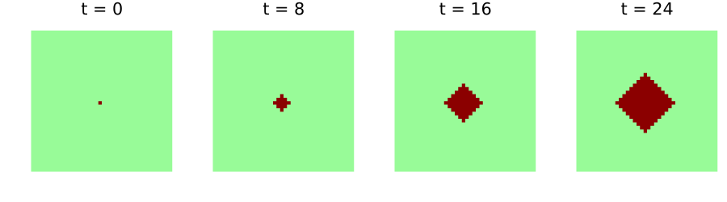
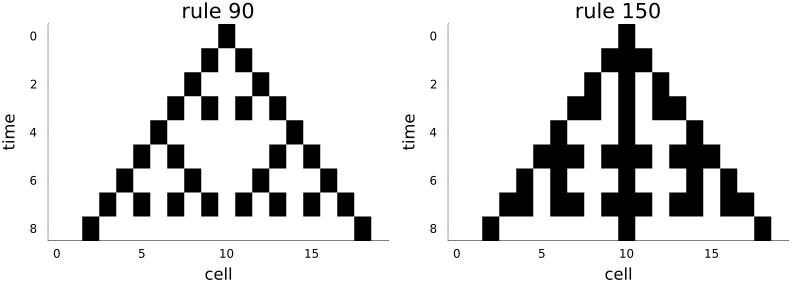

# Products and multi-layer models
Simon Frost

- [Overview](#overview)
- [Products of full shifts](#products-of-full-shifts)
- [Two layer updates](#two-layer-updates)
- [The pair is the model](#the-pair-is-the-model)
- [The laws of a product](#the-laws-of-a-product)
- [Running layers side by side](#running-layers-side-by-side)
- [Copying and deleting](#copying-and-deleting)

## Overview

Many ecological cellular automata have several layers: a host and a
pest, a crop and a pathogen, a forest and a fire. The category of
cellular automata over a group has products ([Castillo-Ramirez et al.
2025](#ref-CastilloRamirez2025)). The state of a two-layer model is a
configuration of pairs, and any two automata from the same domain pair
into one automaton into the product. A two-layer model is therefore
exactly the pair of its two layer updates, each of which may read both
layers. This vignette builds such a model, a host plant and an aphid
vector, and checks the laws that make it a product.

``` julia
ENV["GKSwstype"] = "100"
using CategoricalCellularAutomata
using CellularAutomataCore: CellularAutomataCore, CAProblem, solve
using Plots
using Random
```

## Products of full shifts

The objects of the category are full shifts `A^G`, all configurations
with values in an alphabet `A`. Their product is the full shift of
pairs, and its configurations hold tuples:

``` julia
G = TorusGroup(40, 40)
H = FullShift(FinAlphabet(Int8[0, 1]), G)          # host: healthy, infected
V = FullShift(FinAlphabet(Int8[0, 1, 2, 3]), G)    # aphid density
X = otimes(H, V)
(X, length(alphabet(X)))
```

    (FullShift(Int8[0, 1] ⊗ Int8[0, 1, 2, 3], TorusGroup(40, 40)), 8)

The product is strictly associative: `(A ⊗ B) ⊗ C` and `A ⊗ (B ⊗ C)` are
the same full shift, whose values are flat tuples `(a, b, c)`.

## Two layer updates

Each layer has its own update, a cellular automaton from the product (it
may read both layers) to its own layer. A healthy plant is infected when
two or more aphids are on it, and an infected plant stays infected:

``` julia
host = CellularAutomaton(G, [(0, 0)], p -> begin
                             h, v = only(p)
                             return h == 1 || v >= 2 ? Int8(1) : Int8(0)
                         end; dom=X, codom=H)
```

    CellularAutomaton over TorusGroup(40, 40) with memory set [(0, 0)]: Int8[0, 1] ⊗ Int8[0, 1, 2, 3] → Int8[0, 1]

Aphids breed to the maximum density on infected plants and otherwise
spread from crowded cells, losing one level of density with each move.
The update reads the cell and its four nearest neighbours:

``` julia
nearest = [(0, 0), (1, 0), (39, 0), (0, 1), (0, 39)]
aphids = CellularAutomaton(G, nearest, p -> begin
                               h = p[1][1]
                               h == 1 && return Int8(3)
                               return Int8(max(0, maximum(q[2] for q in p) - 1))
                           end; dom=X, codom=V)
```

    CellularAutomaton over TorusGroup(40, 40) with memory set [(0, 0), (1, 0), (39, 0), (0, 1), (0, 39)]: Int8[0, 1] ⊗ Int8[0, 1, 2, 3] → Int8[0, 1, 2, 3]

## The pair is the model

The pair of the two updates is one cellular automaton from the product
to itself: the whole model. Its memory set is the union of the two
memory sets.

``` julia
model = pair(host, aphids)
(dom(model) == codom(model) == X, memory_set(model))
```

    (true, [(0, 0), (1, 0), (39, 0), (0, 1), (0, 39)])

It runs on CellularAutomataCore like any other automaton, with a state
array of tuples:

``` julia
u0 = fill((Int8(0), Int8(0)), 40, 40)
u0[20, 20] = (Int8(1), Int8(0))
sol = solve(CAProblem(model, u0, 24); saveat=8)
plot([heatmap(first.(u); c=[:palegreen, :darkred], clims=(0, 1), colorbar=false,
              aspect_ratio=:equal, framestyle=:none, title="t = $t")
      for (t, u) in zip(sol.t, sol.u)]...; layout=(1, 4), size=(900, 250))
```



Aphids breeding on the first infected plant raise the density on its
neighbours, which become infected in turn, and so the infection spreads
as a front. Aphids move only to the four nearest cells, so the front is
a diamond: its distance from the first plant, in steps along the grid,
grows like this:

``` julia
radius(u) = maximum(abs(I[1] - 20) + abs(I[2] - 20) for I in findall(==(1), first.(u)))
full = solve(CAProblem(model, u0, 24))
[t => radius(u) for (t, u) in zip(full.t, full.u) if t % 4 == 0]
```

    7-element Vector{Pair{Int64, Int64}}:
      0 => 0
      4 => 1
      8 => 2
     12 => 4
     16 => 5
     20 => 6
     24 => 8

About one cell every three steps: one step for the aphids to breed on a
newly infected plant, one to spread to its neighbours, and one for those
to become infected.

## The laws of a product

Composing the pair with the projections gives back each update, and
these equalities hold for every configuration, because `==` compares
local rules:

``` julia
(compose(model, proj1(H, V)) == host, compose(model, proj2(H, V)) == aphids)
```

    (true, true)

The pair is also the only automaton with that property. Any automaton
into the product is the pair of its two projections:

``` julia
pair(compose(model, proj1(H, V)), compose(model, proj2(H, V))) == model
```

    true

Together these say that a two-layer model *is* its two layer updates and
nothing more: to change one layer’s dynamics is to change one component
of the pair.

## Running layers side by side

`otimes` runs two automata on two independent layers, each reading only
its own. On the product of two rings it runs rule 90 and rule 150 side
by side, and it is the pair of each rule after the projection onto its
layer:

``` julia
Z = CyclicGroup(20)
B = FinAlphabet(0:1)
rule90 = CellularAutomaton(Z, [19, 1], p -> xor(p...); dom=B)
rule150 = CellularAutomaton(Z, [19, 0, 1], p -> xor(p...); dom=B)
Y = dom(rule90)
side_by_side = otimes(rule90, rule150)
side_by_side == pair(compose(proj1(Y, Y), rule90), compose(proj2(Y, Y), rule150))
```

    true

``` julia
z = Configuration(Z, [(i == 10 ? 1 : 0, i == 10 ? 1 : 0) for i in 0:19])
layers = [parent(z)]
for _ in 1:8
    z = side_by_side(z)
    push!(layers, parent(z))
end
grid = permutedims(reduce(hcat, layers))
plot(heatmap(0:19, 0:8, first.(grid); c=[:white, :black], yflip=true, colorbar=false,
             title="rule 90"),
     heatmap(0:19, 0:8, last.(grid); c=[:white, :black], yflip=true, colorbar=false,
             title="rule 150"); layout=(1, 2), size=(800, 290), xlabel="cell", ylabel="time",
     bottom_margin=5Plots.mm, left_margin=3Plots.mm)
```



## Copying and deleting

A cartesian category also has a copy `mcopy(X) : X → X ⊗ X` and a
deletion `delete(X) : X → munit()`, and for deterministic automata both
are *natural*: copying the output of an automaton is the same as running
it twice on a copy of the input.

``` julia
(compose(rule90, mcopy(Y)) == pair(rule90, rule90),
 compose(rule90, delete(Y)) == delete(Y))
```

    (true, true)

This is what fails for stochastic automata: two independent runs of a
random rule are not the same as one run copied. That is the subject of
the stochastic vignette, where cellular automata live in a Markov
category rather than a cartesian one.

<div id="refs" class="references csl-bib-body hanging-indent">

<div id="ref-CastilloRamirez2025" class="csl-entry">

Castillo-Ramirez, Alonso, Alejandro Vazquez-Aceves, and Angel
Zaldivar-Corichi. 2025. *Categorical Products of Cellular Automata*.
<https://arxiv.org/abs/2503.21567>.

</div>

</div>
