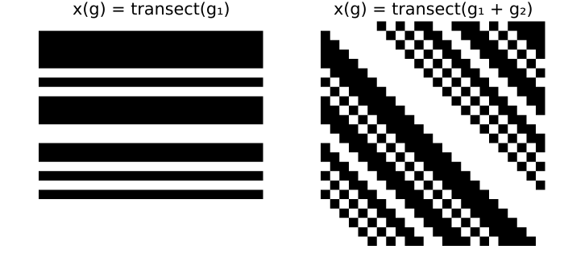
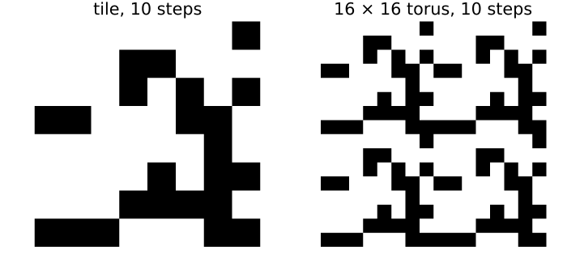

# Generalised cellular automata
Simon Frost

- [Overview](#overview)
- [Homomorphisms and pullbacks](#homomorphisms-and-pullbacks)
- [Generalised cellular automata](#generalised-cellular-automata)
- [Composition](#composition)
- [Pushforward and pullback commute](#pushforward-and-pullback-commute)
- [Periodic landscapes](#periodic-landscapes)

## Overview

A cellular automaton maps configurations over one group to
configurations over the same group. Generalised cellular automata relax
this: given a group homomorphism `φ : H → G`, a `φ`-cellular automaton
maps configurations over `G` to configurations over `H`
([Castillo-Ramirez et al. 2025](#ref-CastilloRamirez2025),
[2026](#ref-CastilloRamirez2026)). This covers moves between spaces that
modellers make all the time: from a small periodic tile to a large
torus, from a one-dimensional transect to a two-dimensional field, from
a fine grid to a coarse one. This vignette introduces homomorphisms,
pullbacks and generalised automata, and checks their composition and
factorisation.

``` julia
ENV["GKSwstype"] = "100"
using CategoricalCellularAutomata
using CellularAutomataCore: CellularAutomataCore, Life, Torus
using Plots
using Random
```

## Homomorphisms and pullbacks

A group homomorphism `φ : H → G` respects multiplication:
`φ(a b) = φ(a) φ(b)`. Reduction modulo 4 is one from `Z_12` to `Z_4`,
and `GroupHom` checks the property on every pair of elements:

``` julia
Z12, Z4 = CyclicGroup(12), CyclicGroup(4)
mod4 = GroupHom(h -> h % 4, Z12, Z4)
println([mod4(h) for h in elements(Z12)])
```

    [0, 1, 2, 3, 0, 1, 2, 3, 0, 1, 2, 3]

A homomorphism moves configurations the other way, by *pullback*:
`(φ* x)(h) = x(φ(h))`. Pulling a configuration on the four-cell ring
back along reduction modulo 4 repeats it three times around the
twelve-cell ring:

``` julia
tile = Configuration(Z4, [1, 1, 0, 0])
println(parent(pullback(mod4, tile)))
```

    [1, 1, 0, 0, 1, 1, 0, 0, 1, 1, 0, 0]

Two homomorphisms from a torus to a ring turn a transect, a
one-dimensional configuration, into a two-dimensional one. The
projection onto the first coordinate gives stripes, and the sum of the
coordinates gives diagonal stripes:

``` julia
n = 24
Zn, T2 = CyclicGroup(n), TorusGroup(n, n)
first_coordinate = GroupHom(g -> g[1], T2, Zn)
coordinate_sum = GroupHom(g -> mod(g[1] + g[2], n), T2, Zn)
transect = Configuration(Zn, Int.(rand(Xoshiro(3), n) .< 0.4))
plot(heatmap(parent(pullback(first_coordinate, transect)); c=[:white, :black],
             colorbar=false, title="x(g) = transect(g₁)"),
     heatmap(parent(pullback(coordinate_sum, transect)); c=[:white, :black],
             colorbar=false, title="x(g) = transect(g₁ + g₂)");
     layout=(1, 2), size=(700, 330), aspect_ratio=:equal, framestyle=:none)
```



## Generalised cellular automata

A `φ`-cellular automaton `T : A^G → B^H` has a memory set `S` in `G` and
a local rule `μ`, and reads each cell `h` of `H` through `φ`:

    T(x)(h) = μ((x(s φ(h)))_{s ∈ S}).

Every one is an ordinary cellular automaton over `G` followed by the
pullback along `φ`, and that is how it is built and stored. Here
elementary rule 30 on the transect is lifted to the torus along the sum
of the coordinates, the example of Castillo-Ramirez et al.
([2025](#ref-CastilloRamirez2025)):

``` julia
B = FinAlphabet(0:1)
rule30(p) = p[1] ⊻ (p[2] | p[3])
lifted = GeneralizedCA(coordinate_sum, [n - 1, 0, 1], rule30; dom=B)
```

    GeneralizedCA over GroupHom(TorusGroup(24, 24) → CyclicGroup(24)) with memory set [23, 0, 1]: [0, 1] → [0, 1]

Its value at a cell of the torus depends only on the sum of the cell’s
coordinates, so its images are constant along diagonals:

``` julia
y = lifted(transect)
all(y[(i, j)] == y[(mod(i + 1, n), mod(j - 1, n))] for i in 0:(n - 1), j in 0:(n - 1))
```

    true

`factorize` returns the homomorphism and the ordinary automaton, and
`==` confirms the factorisation:

``` julia
φ, τ = factorize(lifted)
(τ, lifted == compose(τ, pullback(φ, B)))
```

    (CellularAutomaton over CyclicGroup(24) with memory set [23, 0, 1]: [0, 1] → [0, 1], true)

## Composition

Generalised automata compose. A `φ`-automaton `A^G → B^H` followed by a
`ψ`-automaton `B^H → C^K` is a `(φ ∘ ψ)`-automaton `A^G → C^K`, whose
memory set is `{s φ(t)}` in `G`. Here the lifted rule 30 is followed by
Life on the torus, which as an ordinary automaton is one over the
identity homomorphism:

``` julia
life = CellularAutomaton(Life(), Torus(n, n); alphabet=B)
both = compose(lifted, life)
(both.hom == coordinate_sum, length(memory_set(both)), both(transect) == life(lifted(transect)))
```

    (true, 7, true)

The composite reads seven cells of the transect: Life reads the 3 × 3
square around a cell, whose coordinate sums span five consecutive
values, and rule 30 reads one more cell on each side of those.

## Pushforward and pullback commute

A map of alphabets `f : A → B` acts on every cell at once, the
*pushforward* `f_*`. Here it is a survey that records severe disease
(state 2) as present and anything milder as absent. It does not matter
whether the survey is taken on the transect and then pulled back to the
field, or the transect is pulled back and then surveyed
([Castillo-Ramirez et al. 2026](#ref-CastilloRamirez2026)):

``` julia
severity = FinAlphabet(0:2)
present = v -> Int(v == 2)
(compose(pushforward(present, Zn; dom=severity, codom=B), pullback(coordinate_sum, B)) ==
 compose(pullback(coordinate_sum, severity), pushforward(present, T2; dom=severity, codom=B)))
```

    true

## Periodic landscapes

A field made of copies of one tile can be simulated on the tile alone.
The reduction `π : Z_16 × Z_16 → Z_8 × Z_8` turns a configuration on an
8 × 8 tile into a periodic one on a 16 × 16 torus. Life on the tile
followed by the pullback is the pullback followed by Life on the large
torus:

``` julia
B8 = FinAlphabet(Int8[0, 1])
small = CellularAutomaton(Life(), Torus(8, 8); alphabet=B8)
large = CellularAutomaton(Life(), Torus(16, 16); alphabet=B8)
π = GroupHom(g -> mod.(g, 8), TorusGroup(16, 16), TorusGroup(8, 8))
compose(small, pullback(π, B8)) == compose(pullback(π, B8), large)
```

    true

`==` checks this for every configuration on the tile, which is to say
for every periodic configuration of the large torus with that period.
Iterating both ways from one tile shows the same pattern:

``` julia
x = Configuration(TorusGroup(8, 8), Int8.(rand(Xoshiro(5), 0:1, 8, 8)))
a, b = x, pullback(π, x)
for _ in 1:10
    a, b = small(a), large(b)
end
plot(heatmap(parent(a); c=[:white, :black], colorbar=false, title="tile, 10 steps"),
     heatmap(parent(b); c=[:white, :black], colorbar=false, title="16 × 16 torus, 10 steps");
     layout=(1, 2), size=(700, 330), aspect_ratio=:equal, framestyle=:none)
```



``` julia
b == pullback(π, a)
```

    true

The square holds because the two runs use the same rule, and an offset
in its neighbourhood names the same cells, through `π`, on the tile and
on the large torus. The next vignette changes the alphabet rather than
the group: to vector spaces over a finite field, and to ordered sets.

<div id="refs" class="references csl-bib-body hanging-indent">

<div id="ref-CastilloRamirez2025" class="csl-entry">

Castillo-Ramirez, Alonso, Alejandro Vazquez-Aceves, and Angel
Zaldivar-Corichi. 2025. *Categorical Products of Cellular Automata*.
<https://arxiv.org/abs/2503.21567>.

</div>

<div id="ref-CastilloRamirez2026" class="csl-entry">

Castillo-Ramirez, Alonso, Alejandro Vazquez-Aceves, and Angel
Zaldivar-Corichi. 2026. *A Categorical Framework for Cellular Automata*.
<https://arxiv.org/abs/2602.04049>.

</div>

</div>
